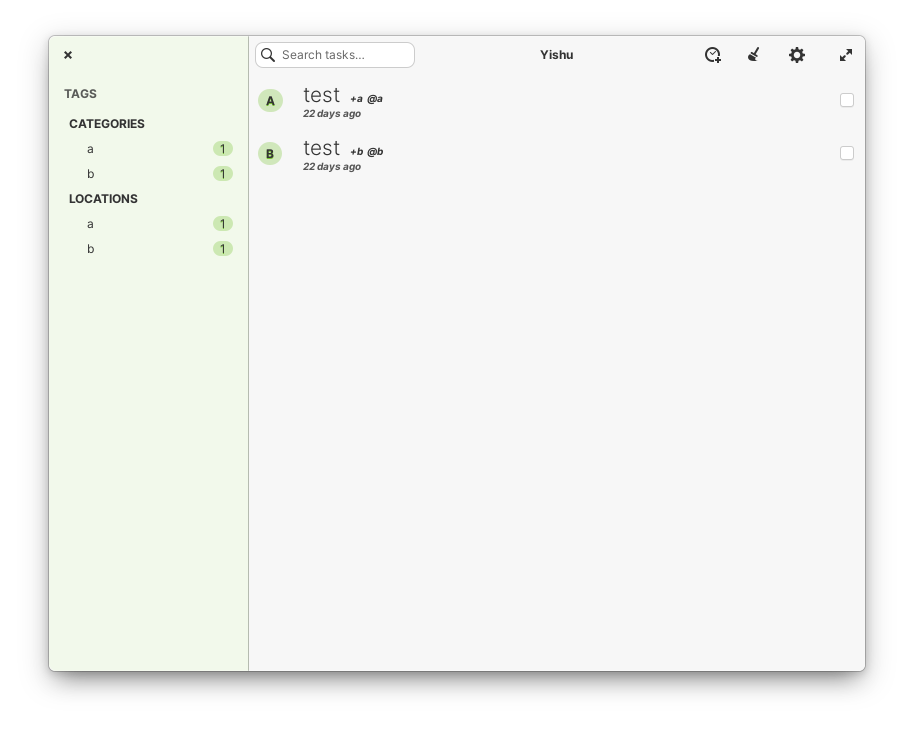

#  Yishu (艺术)

[English](README.md) | **Русский**

## Простой и оригинальный клиент Todo.txt

[](https://appcenter.elementary.io/com.github.lainsce.yishu)

[](https://travis-ci.org/lainsce/yishu)
[](http://www.gnu.org/licenses/gpl-3.0)



## Пожертвования

Хотите поддержать развитие этого приложения и вывести его на новый уровень? Тогда:

[Поддержите меня на Patreon](https://www.patreon.com/lainsce)

## Зависимости

Перед сборкой убедитесь, что у вас установлены следующие зависимости.

```bash
granite
gtk+-3.0
meson
libhandy-1
```

Сборка

Просто клонируйте этот репозиторий, затем выполните:

```bash
meson build && cd build
meson configure -Dprefix=/usr
sudo ninja install
```
